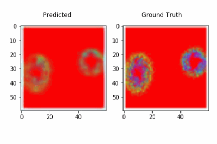
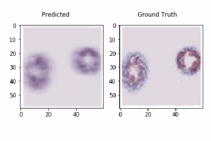
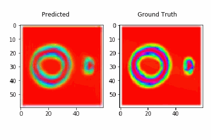
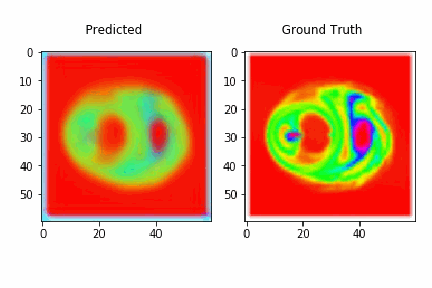
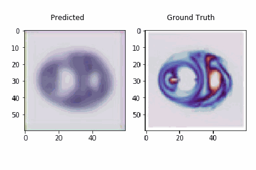
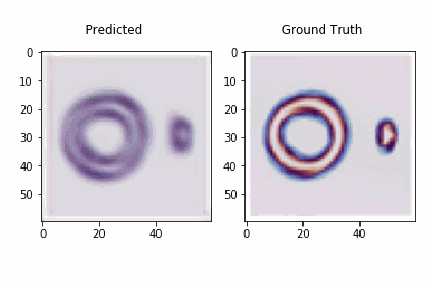

# Hi, I'm Shashwat 👋

---

## 🌌 What I work on

My PhD thesis is **_Revealing the family of massive black holes with LISA_**.

Every large galaxy hides a massive black hole (MBH), but we know very little about how they are born, grow and merge. LISA, the space-based gravitational-wave observatory, will detect signals from these systems. My work is the statistical machinery that turns those detections into answers about the **MBH population** as a whole.

| 🔭 Source | 💡 What it tells us |
| --- | --- |
| **EMRIs**: extreme mass-ratio inspirals | Stellar-mass compact objects spiralling into an MBH. They probe the MBH mass function and the dense nuclei around it. |
| **TDEs**: tidal disruption events | Stars torn apart by MBHs. They give a complementary, electromagnetic handle on the same population. |
| **MBH binaries and lensing** | Gravitational-wave lensing as a probe of fuzzy dark matter (FDM). |
| **Hierarchical inference** | The framework that combines noisy individual events into population-level constraints. |

### 🎞️ Visuals from my work

 

---

## 🧰 Toolbox

**Topics:** Bayesian inference · gravitational waves · LISA · population synthesis · MCMC / nested sampling · numerical simulation

---

## 📊 GitHub stats

---

## 📫 Get in touch

I'm happy to chat about gravitational waves, black hole populations, or statistics for astrophysics.

📎 A cheatsheet of Git commands I use is in [docs/git-cheatsheet.md](docs/git-cheatsheet.md).
